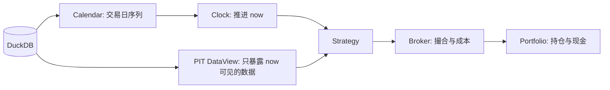

## 项目设计

本项目理应是我找工作时展示的一个设计, 定位为以时间为主要对象, 可以进行时间模拟来运行一次交易期间的内容
主要设计是一个时间模拟器. 在这之前先确保已经有数据文件并且存储了数据, 包含交易日期, 只要某个日期里面有至少一条日期就将其作为后续时间模拟器的时间内容

### 定位与范围

- 模拟器定位: **回测引擎** (策略 → 下单 → 撮合 → 持仓 → 绩效)
- 时间粒度: **日频, 每个交易日只在收盘时刻决策一次**
- 标的范围: **全部标普500成员**
- 展示形式: 暂不确定, 面试前再决定; **不做 CLI**

---

### 时点 (Point-in-Time) 规则

模拟器在交易日 T 收盘时, 只能看到 T 收盘时已经公开的信息

| 数据 | 可见条件 |
|---|---|
| `prices` | `date <= T` (收盘决策, 当天 close 可见) |
| `fundamental_*` | 按 **`filed`** 判断, 不按 `end_date`; 保守起见 `filed` 之后的下一个交易日才可见, 即 `filed < T` |
| 同一指标被修订 | 在可见的记录中, 取 `filed` 最新的那条 (同一 `filed` 再按 `accn` 区分) |
| `universe` | `snapshot_date <= T` 的最新快照 (见下方已知限制) |

`fy`, `fp`, `frame` 只作为原始辅助信息保留, 不用来替代实际报告日期

---

### 已知限制

- **代码复用 (诈尸) 与改名**:
  - `raw_data.duckdb` 没有跨时间不变的证券 ID, 同一个代码在旧公司退市后可能被新公司重新使用. `sources/raw_prices.py` 按前后行情间隔超过 120 个交易日自动切段, 最新段沿用原代码, 旧段改名为 `{symbol}~{YYYYMMDD}` (名单导出至 `data/reused_tickers.csv`)
  - 同一家公司改名 (例如 `FB` → `META`) 不会被接成一条连续序列, 改名前的历史仍保留在旧代码上
- **免费行情质量**: `raw_ohlcv` 存在少量 OHLC 自相矛盾 (例如 `high < max(open, close)`) 和 0 价毛刺; 入库时只剔除 `close <= 0` 的行以及比例/金额 `<= 0` 的无效事件, 其余保留原样
- **universe 元数据不完整**:
  - 历史成分来自 `fja05680/sp500` CSV (仅提供日期和代码列表), 映射到当前仍在交易的段时可从 Wikipedia / SEC 补全 `cik`, `name`, `sub_industry`; 早年调出或已切为旧段的成员 `cik` 暂填占位 `'0000000000'`, `sub_industry` 为空
  - `universe.exchange` 取自 `raw_symbol.listing_exchange`, 仅对最新段填充; `universe.sic` 当前为空, 留给后续用 SEC 数据补齐

---

### 数据库表

日频的`prices`表
```SQL
CREATE TABLE IF NOT EXISTS prices(
    date DATE NOT NULL,
    ticker VARCHAR NOT NULL,
    open DOUBLE,
    high DOUBLE,
    low DOUBLE,
    close DOUBLE NOT NULL,
    adj_close DOUBLE,
    volume BIGINT,
    PRIMARY KEY(ticker, date),
    CHECK (volume >= 0)
);
```
---
标的的`universe`表
```SQL
CREATE TABLE IF NOT EXISTS universe (
    snapshot_date DATE NOT NULL,
    ticker VARCHAR NOT NULL,

    cik VARCHAR NOT NULL,           -- 补零到 10 位, 与 SEC companyfacts 一致
    name VARCHAR NOT NULL,
    exchange VARCHAR,
    sic VARCHAR,
    sub_industry VARCHAR,

    PRIMARY KEY (snapshot_date, ticker)
);
```
---
装载基本面的`fundamental_instant`基本面时刻表
```SQL
CREATE TABLE IF NOT EXISTS fundamental_instant (
    cik VARCHAR NOT NULL,
    taxonomy VARCHAR NOT NULL,      -- 指标所属分类，例如 us-gaap
    tag VARCHAR NOT NULL,           -- 原始指标名，例如 Assets
    unit VARCHAR NOT NULL,          -- 单位，例如 USD、shares
    end_date DATE NOT NULL,         -- 指标对应的时点
    val DOUBLE NOT NULL,            -- 披露的数值
    accn VARCHAR NOT NULL,          -- SEC 申报编号，用来区分披露文件
    filed DATE NOT NULL,            -- 申报日期，用于判断当时是否已披露
    form VARCHAR NOT NULL,          -- 申报类型，例如 10-K、10-Q
    fy INTEGER,
    fp VARCHAR,
    frame VARCHAR,

    PRIMARY KEY (cik, taxonomy, tag, unit, end_date, accn)
);
```
---
装载基本面的`fundamental_period`基本面时间段表
```SQL
CREATE TABLE IF NOT EXISTS fundamental_period (
    cik VARCHAR NOT NULL,
    taxonomy VARCHAR NOT NULL,
    tag VARCHAR NOT NULL,
    unit VARCHAR NOT NULL,
    start_date DATE NOT NULL,
    end_date DATE NOT NULL,
    val DOUBLE NOT NULL,
    accn VARCHAR NOT NULL,
    filed DATE NOT NULL,
    form VARCHAR NOT NULL,
    fy INTEGER,
    fp VARCHAR,
    frame VARCHAR,

    PRIMARY KEY (cik, taxonomy, tag, unit, start_date, end_date, accn),
    CHECK (start_date <= end_date)
);
```
---
交易日历 `calendar` 视图: `prices` 中至少有一条记录的日期即为交易日
```SQL
CREATE OR REPLACE VIEW calendar AS
SELECT DISTINCT date
FROM prices;
```
---

### 架构



每个交易日的流程: 推进到 T → 更新 PIT 可见数据 → 策略在收盘读取数据并下单 → Broker 撮合 → Portfolio 记账

---

### 里程碑

| 阶段 | 内容 | 完成标准 |
|---|---|---|
| M0 | 修正 DDL 与数据源字段, 补全设计文档, 首次提交 | 能建库, 测试全部通过 |
| M1 | 数据管道: universe → prices → fundamentals 入库 | 一次调用把全标普500数据装入 `lab.duckdb` |
| M2 | Calendar 与 Clock | 可以按交易日逐日推进, 跳到指定日期 |
| M3 | PIT DataView | 有测试证明任何 T 时刻都取不到未来数据 (价格, 基本面修订) |
| M4 | Broker 与 Portfolio: 收盘价撮合, 手续费, 滑点 | 跑通一个买入持有的例子并与手算结果一致 |
| M5 | (预留, 暂不考虑) 示例策略, 绩效报告, 展示层 | — |

---

### 后续数据源 (银行业扩展)

针对标普500内的银行业 (包括传统银行和非传统银行), 后续计划增加:

- **CRSP**: 历史价格与历史成员, 用于消除幸存者偏差
- **FDIC**: 银行机构信息与财务数据
- **FFIEC**: Call Report 等监管报表
- **Federal Reserve**: 宏观与利率数据, 银行控股公司报表

这些数据源同样遵守上面的时点规则, 需要为每个数据源确定可见日期字段 (相当于 SEC 的 `filed`)
